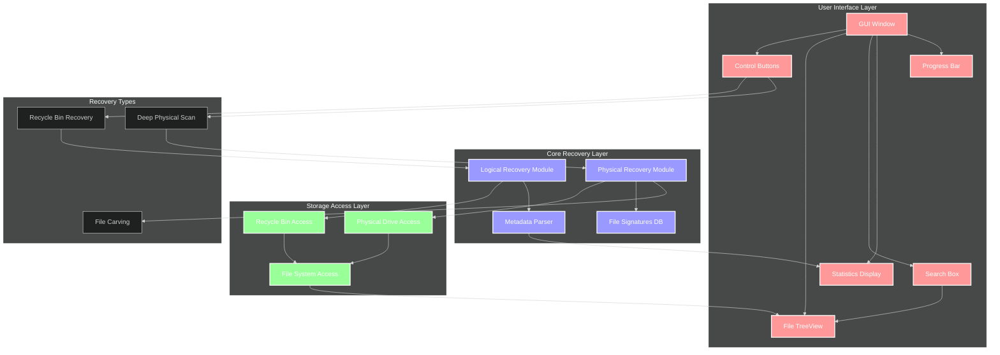

# Data Recovery Tool - System Architecture

## Component Description

1. **User Interface Layer**
   - GUI Window: Main application window (tkinter)
   - Control Buttons: Start Scan, Stop Scan, Recover Selected
   - File TreeView: Displays found files and metadata
   - Search Box: Live file search functionality
   - Statistics Display: Shows recovery statistics
   - Progress Bar: Displays operation progress

2. **Core Recovery Layer**
   - Logical Recovery Module: Handles Recycle Bin recovery
   - Physical Recovery Module: Manages physical drive scanning
   - File Signatures DB: Stores file magic numbers
   - Metadata Parser: Processes file metadata

3. **Storage Access Layer**
   - Recycle Bin Access: Interfaces with Windows Recycle Bin
   - Physical Drive Access: Raw disk access
   - File System Access: File operations management

4. **Recovery Types**
   - Recycle Bin Recovery: Recovers from $Recycle.Bin
   - Deep Physical Scan: Raw drive scanning
   - File Carving: Signature-based file recovery

## Data Flow

1. **Recovery Process**
   - User initiates scan through UI
   - Logical Recovery checks Recycle Bin
   - Physical Recovery scans drives
   - Found files displayed in TreeView
   - Progress updated in real-time

2. **File Recovery**
   - User selects files in TreeView
   - System checks recovery type
   - Executes appropriate recovery method
   - Updates progress and statistics

## Security Features

- Administrator privilege checks
- Safe file handling
- Permission management
- Error handling and recovery

## Key Features

1. **File Detection**
   - Multiple file signature support
   - Metadata preservation
   - Directory structure recovery

2. **User Interface**
   - Real-time progress updates
   - Live search functionality
   - Sortable file list
   - Detailed file information

3. **Recovery Options**
   - Recycle Bin recovery
   - Physical drive scanning
   - Selective file recovery
   - Directory recovery support